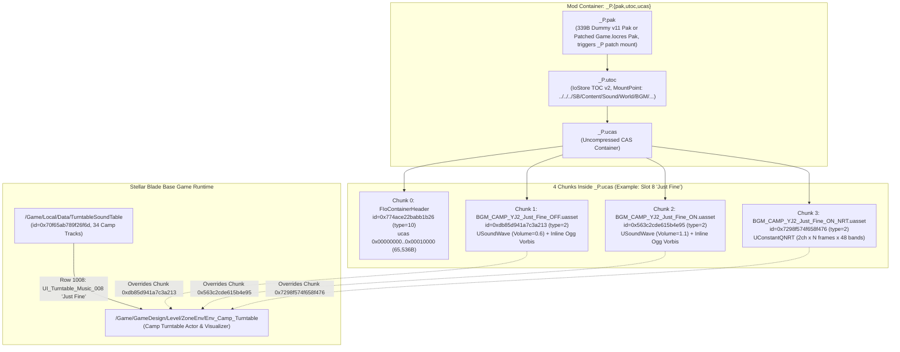

# Stellar Blade Custom Camp Music — Technical Architecture & Binary Format Reference

> [!IMPORTANT]
> **Executive Summary**
> Stellar Blade (`SB-Win64-Shipping.exe`, Unreal Engine `4.26.2.0`, Game FileVersion `1.5.0.0`) loads camp turntable audio through the **UE 4.26 Zen Loader / IoStore** container system (`.pak` + `.utoc` + `.ucas`).
> While the base game (`pakchunk0-WindowsNoEditor.ucas`) cooks camp music as Oodle-compressed (`oo2::OodleLZ_Decompress` at VMA `0x144e6e630`) **Bink Audio** (`BINKA10000-1-1-1-1-1`) with **Unversioned Properties** (`PackageFlags = 0x80002000`), the engine natively links `libogg_64.dll` and `libvorbis_64.dll` and accepts **uncompressed IoStore blocks (`method = 0`)** containing standard **Versioned Properties** (`PackageFlags = 0x80000000`) and standard **Ogg Vorbis** (`OGG10000-1-1-1-1-1`) payloads.

---

## 1. Analyzed Game Artifacts & Binary Identity

| Target Artifact | SHA-256 Digest | Size (Bytes) | Analysis Method | Key Findings (Observed vs. Inferred) |
| :--- | :--- | :--- | :--- | :--- |
| `SB\Binaries\Win64\SB-Win64-Shipping.exe` | `4c6142ab006900b06daa8b1160772c8bf74e4918ff618107d5fae63485adeaa6` | `365,620,224` | PE header, resource & symbol inspection | **Observed**: PE32+ x86-64 executable, stripped symbol table, 14 sections (`.debug$P` code section at VMA `0x140001000..0x1455b3000`, `.link` rdata/IAT at `0x1455b3000`, `.edata` protected region at `0x147793000`). `RT_VERSION` at file offset `0x72b9540` (`120300768`, `828` bytes) declares `FileVersion = 1.5.0.0`, `ProductVersion = 4.26.2.0` (Unreal Engine 4.26.2). Statically links `oo2::OodleLZ_Decompress` at VMA `0x144e6e630` (file offset `0x4e6da30`). |
| `SB.exe` | `b78cb0acc75cf646b426751e75f02bcc764f2cee458198b3ecfd42ac5943302c` | `459,776` | PE header & disassembly | **Observed**: Root bootstrapper launcher that checks Windows version/registry and spawns `SB\Binaries\Win64\SB-Win64-Shipping.exe`. |
| `SB\Content\Paks\pakchunk0-WindowsNoEditor.utoc` | Base game TOC (`23,190,622` bytes) | `23,190,622` | Direct binary dissection + in-memory `OodleLZ_Decompress` | **Observed**: `FIoStoreTocHeader` Version 3, `Entries = 221,835`, `Blocks = 348,277`, `BlockSize = 1 MiB` (`0x100000`), `CompressionMethod[1] = Oodle`. Contains `TurntableSoundTable.uasset` (TOC index `157646`), `Env_Camp_Turntable.uasset` (`130228`), `Turntable_ConstantQNRT_Setting.uasset` (`167816`), and all 34 camp music track triplets. |

### Scope & Remaining Unknowns
- **Observed**: Static PE structure, embedded Oodle decompressor (`0x144e6e630`), `.pak`/`.utoc`/`.ucas` layouts, `TurntableSoundTable.uasset` rows, `Game.locres` English titles, `USoundWave` and `UConstantQNRT` byte layouts.
- **Inferred**: Runtime transition behavior between `_ON` (`MusicPath`) and `_OFF` (`NoiseMusicPath`) is inferred from `Env_Camp_Turntable.uasset` (`NeedNoise`, `RefreshSound`, `RefreshDuckSound`, `Turntable.uasset`) and `TurntableSoundTable.uasset` property names without launching the live game process.
- **Unknowns**: Live Denuvo VM execution paths inside `.edata` (`0x147793000..0x155b64338`) were not executed; only the unencrypted `.debug$P` Oodle decompression routine was invoked in-memory on read-only `.ucas`/`.pak` blocks.

---

## 2. How Camp Music Mods Work Under the Hood



### 2.1 The Three Assets Per Camp Track (`_ON`, `_OFF`, `_ON_NRT`)
Decompressing `/Game/Local/Data/TurntableSoundTable.uasset` (TOC index `157646`, `16,074` bytes) and `/Game/GameDesign/Level/ZoneEnv/Env_Camp_Turntable.uasset` (`18,030` bytes) reveals that every camp turntable song is defined by a `SBTurntableSoundTableProperty` row referencing three assets:

1. **`MusicPath` (`<TrackName>_ON.uasset`)**:
   - Class: `/Script/Engine.SoundWave` (`0x44f26264628e498d`)
   - Role: Primary camp music playback (`Volume = 1.1`).
2. **`NoiseMusicPath` (`<TrackName>_OFF.uasset`)**:
   - Class: `/Script/Engine.SoundWave` (`0x44f26264628e498d`)
   - Role: Secondary/muffled turntable state checked via `Env_Camp_Turntable::NeedNoise` (`Volume = 0.6`).
   - By default, both `_OFF` and `_ON` can embed the same Ogg Vorbis stream (differing only in asset name, `Volume = 0.6f` vs `1.1f`, and `CompressedDataGuid`), or you can provide a dedicated muffled stream for `_OFF`.
3. **`QNRTAssetPath` (`<TrackName>_ON_NRT.uasset` / `<TrackName>_NRT.uasset`)**:
   - Class: `/Script/AudioSynesthesia.ConstantQNRT` (`0x46b0226f8f726a72`)
   - Role: Precomputed Constant-Q Transform (CQT) frequency spectrum frames sampled every `0.01s` (`100 Hz`) used by the camp turntable reactivity/visualizer.
   - **Base Game vs. Mod Layout**:
     - Base game `orig_BGM_CAMP_YJ2_Just_Fine_ON_NRT.uasset` (`1,744,184` bytes) uses `/Game/Sound/World/BGM/VendingMachine/Turntable_ConstantQNRT_Setting` (`bDownmixToMono = true`, `NumBands = 20`, `NumBandsPerOctave = 1.5`, `NoiseFloorDb = -40.0`), storing `1` channel × `18,946` frames × `20` floats (`92` bytes/frame).
     - Uncompressed custom mod `UConstantQNRT` assets can use default `UConstantQNRTSettings` (`bDownmixToMono = false`, `NumBands = 48`), storing `2` channels × `N` frames × `48` floats (`204` bytes/frame) matched to the input song's duration.

### 2.2 Exact Binary Layout of a Modded `USoundWave` Zen Asset (Chunk 1 & Chunk 2)
Each custom `USoundWave` chunk consists of four contiguous regions:

1. **Zen `FPackageSummary` + `NameMap` + `ImportMap` + `ExportMap` + `ExportBundles` + `GraphData`** (`0x0000..0x05DF` for `_OFF`, `1,504` bytes):
   - `PackageFlags = 0x80000000` (`PKG_FilterEditorOnly`, versioned tagged properties enabled).
   - `CookedHeaderSize = 0x6C8` (`1,736` bytes for `_OFF`, `0x6C6` = `1,734` bytes for `_ON`).
   - `NameMapHashes`: `uint64 AlgorithmId = 0xC1640000` followed by `CityHash64(name.lower().encode('latin1'))` for each of the 43 names.
   - `FExportMapEntry` (`72` bytes at `0x540`):
     - `CookedSerialOffset = CookedHeaderSize` (`0x6C8` for `_OFF`)
     - `CookedSerialSize = TotalAssetSize - 0x5E0` (`0x360613` = `3,540,499` bytes)
     - `GlobalImportIndex = (2 << 62) | (CityHash64(f"{pkg_path}/{asset_name}".lower().encode("utf-16le")) & 0x3FFFFFFFFFFFFFFF)`
2. **Versioned Tagged Properties** (`0x05E0..0x0785`, `422` bytes):
   - `CompressionQuality` (`IntProperty`) = `30`
   - `StreamingPriority` (`IntProperty`) = `6`
   - `SoundGroup` (`ByteProperty`) = `ESoundGroup::SOUNDGROUP_Music`
   - `bLooping` (`BoolProperty`) = `True`
   - `Volume` (`FloatProperty`) = `0.6f` (`_OFF`) or `1.1f` (`_ON`)
   - `NumChannels` (`IntProperty`) = `2`
   - `SampleRate` (`IntProperty`) = `48000`
   - `SoundClassObject` (`ObjectProperty`) = `PackageIndex(-7)` (`/Game/Sound/SoundAsset/SoundClass/BGM_VendingMachine`)
   - `VirtualizationMode` (`EnumProperty`) = `EVirtualizationMode::PlayWhenSilent`
   - `ConcurrencySet` (`SetProperty`) = `1` element: `PackageIndex(-8)` (`/Game/Sound/SoundAsset/Concurrency/Concurrency_VendingMusic`)
   - `Duration` (`FloatProperty`) = `total_samples / sample_rate` (e.g. `289.00717f`)
   - `TotalSamples` (`FloatProperty`) = `float(total_samples)` (e.g. `13872344.0f`)
   - `AttenuationSettings` (`ObjectProperty`) = `PackageIndex(-6)` (`/Game/Sound/SoundAsset/Attenuations/Common/Default`)
   - Terminator: `FName("None")` (`19 00 00 00 00 00 00 00`)
3. **`USoundWave::Serialize` Bulk Format Container** (`0x0786..0x07AD`, `40` bytes):
   - `bSerializeGuid` (`uint32`) = `0` (`00 00 00 00`)
   - `bCooked` (`uint32`) = `1` (`01 00 00 00`)
   - `NumFormats` (`int32`) = `1` (`01 00 00 00`)
   - `FormatName` (`FMappedName`) = `FName("OGG10000-1-1-1-1-1")` (`1c 00 00 00 00 00 00 00`)
   - `BulkDataFlags` (`uint32`) = `0x48` (`BULKDATA_ForceInlinePayload | BULKDATA_SingleUse`)
   - `ElementCount` (`int32`) = `len(ogg_bytes)`
   - `BulkDataSizeOnDisk` (`int32`) = `len(ogg_bytes)`
   - `BulkDataOffsetInFile` (`int64`) = `0x896` (legacy uexp offset; ignored when `BULKDATA_ForceInlinePayload` is set)
4. **Inline Ogg Vorbis Stream + Trailing `CompressedDataGuid`** (`0x07AE..end`):
   - Raw `.ogg` file bytes (`len(ogg_bytes)` bytes, starting with `OggS`).
   - `16`-byte `FGuid CompressedDataGuid`.

### 2.3 Exact Binary Layout of `UConstantQNRT` (Chunk 3)
After its tagged properties (`Settings = PackageIndex(-4)`, `Sound = PackageIndex(-9)`, `DurationInSeconds = float(duration)`, `None`), `UConstantQNRT` serializes:
```
uint32 bSerializeGuid = 0
float  DurationInSeconds
uint32 bIsSorted = 1
int32  NumChannels (1 for mono / base-game style, or 2 for stereo layout)
For each channel c in 0..NumChannels-1:
    int32 ChannelIndex = c
    int32 NumFrames = floor(DurationInSeconds / 0.01)
    For each frame i in 0..NumFrames-1:
        int32 Channel = c
        float Timestamp = 0.042666666f + i * 0.01f
        int32 NumBands (20 for base-game setting, or 48 for default UE setting)
        float BandDbValues[NumBands] (dB values in range [-90.0f, ~15.0f])
int32 NumChannelIntervals = NumChannels
For each channel c in 0..NumChannels-1:
    int32 ChannelIndex = c
    float IntervalMin = -90.0f (0xC2B40000)
    float IntervalMax = max(BandDbValues) (e.g. 13.4f)
```
Followed by `12` bytes for Export 1 (`DefaultConstantQNRTSettings`: `FName("None")` + `uint32(0)`).

---

## 3. Complete Catalog of All 34 Camp Turntable Tracks

Extracted from `/Game/Local/Data/TurntableSoundTable.uasset` (chunk `0x70f65ab789f26f6d`) and `/SB/Content/Localization/Game/en/Game.locres`. You can target **any** of these 34 tracks by using its asset paths and `CityHash64(utf16le_lower_path)` Chunk IDs:

| UI Key | In-Game English Title | Package Folder (`/Game/Sound/World/BGM/...`) | `_ON` Asset Name & Chunk ID (`FPackageId`) | `_OFF` Asset Name & Chunk ID (`FPackageId`) | `_NRT` Asset Name & Chunk ID (`FPackageId`) |
| :--- | :--- | :--- | :--- | :--- | :--- |
| `UI_Turntable_Music_001` | **The Song of the Sirens** | `VendingMachine` | `BGM_CAMP_MV1_ON`<br>`0x4382d0730bbe8331` | `BGM_CAMP_MV1_OFF`<br>`0xc5509f2b0671ddd7` | `BGM_Camp_MV1_ON_NRT`<br>`0xe7996fc29279c486` |
| `UI_Turntable_Music_002` | **The Song of the Wanderer** | `VendingMachine` | `BGM_CAMP_MV3_ON`<br>`0xe5c106f088df3067` | `BGM_CAMP_MV3_OFF`<br>`0x870527ae4c64febd` | `BGM_CAMP_MV3_ON_NRT`<br>`0xc9095cfcc75a94fb` |
| `UI_Turntable_Music_003` | **The Song of the Traveler** | `VendingMachine` | `BGM_CAMP_MV4_ON`<br>`0xef0cf19c53780551` | `BGM_CAMP_MV4_OFF`<br>`0x1a1ec207e8df1b47` | `BGM_CAMP_MV4_ON_NRT`<br>`0xeac405db573d8371` |
| `UI_Turntable_Music_004` | **The Song of the Nomad** | `VendingMachine` | `BGM_CAMP_MV2_ON`<br>`0x4be4612a89612c88` | `BGM_CAMP_MV2_OFF`<br>`0xfa8827aa443f1dca` | `BGM_CAMP_MV2_ON_NRT`<br>`0x5662814c9a3a3301` |
| `UI_Turntable_Music_005` | **Oasis** | `E05` (NRT in `VendingMachine`) | `BGM_E05_EVENT_Oasis_Camp`<br>`0xab3636eac4d62ca6` | `BGM_E05_EVENT_OASIS_MONO`<br>`0x03372ed7b8575323` | `BGM_E05_EVENT_Oasis_Camp_NRT`<br>`0xb80331d34d4db534` |
| `UI_Turntable_Music_006` | **Don't Forget Me** | `E05` (NRT in `VendingMachine`) | `BGM_E05_EVENT_OASIS_SUMMER_CAMP`<br>`0x058732023177051f` | `BGM_E05_EVENT_OASIS_SUMMER_MONO`<br>`0xd9ea1686b1d65f55` | `BGM_E05_EVENT_OASIS_SUMMER_CAMP_NRT`<br>`0x1f326490cd5dcd61` |
| `UI_Turntable_Music_007` | **Lullaby of Secret** | `VendingMachine` | `BGM_CAMP_YJ1_Lullaby_of_Secret_ON`<br>`0xf257cdcdf04cc888` | `BGM_CAMP_YJ1_Lullaby_of_Secret_OFF`<br>`0xf6259dda83dfc4f7` | `BGM_CAMP_YJ1_Lullaby_of_Secret_ON_NRT`<br>`0x48479aa4726559af` |
| `UI_Turntable_Music_008` | **Just Fine** *(Default CLI Slot)* | `VendingMachine` | `BGM_CAMP_YJ2_Just_Fine_ON`<br>`0x563c2cde615b4e95` | `BGM_CAMP_YJ2_Just_Fine_OFF`<br>`0xdb85d941a7c3a213` | `BGM_CAMP_YJ2_Just_Fine_ON_NRT`<br>`0x7298f574f658f476` |
| `UI_Turntable_Music_009` | **Blur** | `VendingMachine` | `BGM_CAMP_YJ3_Blur_ON`<br>`0x1e9c23bf6711d66c` | `BGM_CAMP_YJ3_Blur_OFF`<br>`0xe56b5f658320260b` | `BGM_CAMP_YJ3_Blur_ON_NRT`<br>`0x6b2ebd72efe6299c` |
| `UI_Turntable_Music_Christmas_01` | **Take me away** | `VendingMachine` | `BGM_CAMP_WINTER_02_ON`<br>`0x510a289610cd495d` | `BGM_CAMP_WINTER_02_OFF`<br>`0xc109059474b4f917` | `BGM_CAMP_WINTER_02_ON_NRT`<br>`0xef46554237e03b45` |
| `UI_Turntable_Music_Christmas_02` | **Dawn (Winter)** | `VendingMachine` | `BGM_CAMP_WINTER_ON`<br>`0x75a703b40553978e` | `BGM_CAMP_WINTER_OFF`<br>`0xf2cf7925b917a80a` | `BGM_CAMP_WINTER_ON_NRT`<br>`0x2b6ef095f22c43d0` |
| `UI_Turntable_Music_Nier_01` | **Emil's Shop** | `Nier` (NRT in `VendingMachine`) | `BGM_NIER_EMIL_ON`<br>`0x14e964c9db2994b9` | `BGM_NIER_EMIL_OFF`<br>`0x1af4e7a277829685` | `BGM_NIER_EMIL_ON_NRT`<br>`0xf399c59f1139dedd` |
| `UI_Turntable_Music_Nier_02` | **Voice of no Return** | `Nier` (NRT in `VendingMachine`) | `BGM_NIER_CAMP_ON`<br>`0xf2a259289e8b4890` | `BGM_NIER_CAMP_OFF`<br>`0xa40a956ee80062f7` | `BGM_NIER_CAMP_ON_NRT`<br>`0xfe9cbacda55733c5` |
| `UI_Turntable_Music_Nikke_01` | **Good Day Commander** | `Nikke/Camp` | `BGM_CAMP_NIKKE_01_ON`<br>`0x91861e472298688d` | `BGM_CAMP_NIKKE_01_OFF`<br>`0x6f56b20c725ac086` | `BGM_CAMP_NIKKE_01_NRT_CAMP`<br>`0x4ab55fea1d370c84` |
| `UI_Turntable_Music_Nikke_02` | **Meditation** | `Nikke/Camp` | `BGM_CAMP_NIKKE_02_ON`<br>`0x749199ba455c02f6` | `BGM_CAMP_NIKKE_02_OFF`<br>`0xc732de94059ec3cf` | `BGM_CAMP_NIKKE_02_NRT_CAMP`<br>`0xad7e4ce6daa1efc0` |
| `UI_Turntable_Music_Nikke_03` | **Lovely Lonely Cat** | `Nikke/Camp` | `BGM_CAMP_NIKKE_03_ON`<br>`0xfc7d9abd4f359ba9` | `BGM_CAMP_NIKKE_03_OFF`<br>`0x16cace181e6283e0` | `BGM_CAMP_NIKKE_03_NRT_CAMP`<br>`0x18a123a5c47251a6` |
| `UI_Turntable_Music_Nikke_04` | **COLORLESS** | `Nikke/Camp` | `BGM_CAMP_NIKKE_04_ON`<br>`0x956b185e1c229231` | `BGM_CAMP_NIKKE_04_OFF`<br>`0x8cc0816cd3e5ef72` | `BGM_CAMP_NIKKE_04_NRT_CAMP`<br>`0x217f0cd60a6a8aca` |
| `UI_Turntable_Music_Nikke_05` | **In Neverland** | `Nikke/Camp` | `BGM_CAMP_NIKKE_05_ON`<br>`0x22132856f99aa3a6` | `BGM_CAMP_NIKKE_05_OFF`<br>`0xf54083eb146fd6d2` | `BGM_CAMP_NIKKE_05_NRT_CAMP`<br>`0xa3f405aa3e9fea80` |
| `UI_Turntable_Music_Nikke_06` | **Midnight Memories** | `Nikke/Camp` | `BGM_CAMP_NIKKE_06_ON`<br>`0xe895b820cc7b0139` | `BGM_CAMP_NIKKE_06_OFF`<br>`0xe6a689d837d3393b` | `BGM_CAMP_NIKKE_06_NRT_CAMP`<br>`0x5b5afb26baa00a2d` |
| `UI_Turntable_Music_Nikke_07` | **Summer Seaside** | `Nikke/Camp` | `BGM_CAMP_NIKKE_07_ON`<br>`0x78474253a63db8e9` | `BGM_CAMP_NIKKE_07_OFF`<br>`0x7d515873dc980eda` | `BGM_CAMP_NIKKE_07_NRT_CAMP`<br>`0xe43789578131a6d8` |
| `UI_Turntable_Music_Nikke_08` | **Camellia** | `Nikke/Camp` | `BGM_CAMP_NIKKE_08_ON`<br>`0xf077e3def2775e20` | `BGM_CAMP_NIKKE_08_OFF`<br>`0x937b673cd524fc5c` | `BGM_CAMP_NIKKE_08_NRT_CAMP`<br>`0x84ebf34178ca8655` |
| `UI_Turntable_Music_Bundle_01` | **Don't Forget Me (Trio)** | `VendingMachine` | `BGM_CAMP_JZ01_DFM_ON`<br>`0x7d56a94fa4c220ff` | `BGM_CAMP_JZ01_DFM_OFF`<br>`0x3b033fdd9df80cd6` | `BGM_CAMP_JZ01_DFM_NRT`<br>`0x1b878494837343ac` |
| `UI_Turntable_Music_Bundle_02` | **Flooded Commercial Sector (Trio)** | `VendingMachine` | `BGM_CAMP_JZ02_FCS_ON`<br>`0xcd6788841ee9b89d` | `BGM_CAMP_JZ02_FCS_OFF`<br>`0x3bdff4db44416f8b` | `BGM_CAMP_JZ02_FCS_NRT`<br>`0xcbde70596fca22e8` |
| `UI_Turntable_Music_Bundle_03` | **Clock Tower (Trio)** | `VendingMachine` | `BGM_CAMP_JZ03_CT_ON`<br>`0xab0733a66af961fd` | `BGM_CAMP_JZ03_CT_OFF`<br>`0x4eeac5a7e7e2ac9e` | `BGM_CAMP_JZ03_CT_NRT`<br>`0xbc426773027472fb` |
| `UI_Turntable_Music_Bundle_04` | **White Night (Trio)** | `VendingMachine` | `BGM_CAMP_JZ04_WN_ON`<br>`0x6ad1a8d2898087fb` | `BGM_CAMP_JZ04_WN_OFF`<br>`0xf31f27261fad1e18` | `BGM_CAMP_JZ04_WN_NRT`<br>`0x9acac13056c90c32` |
| `UI_Turntable_Music_Bundle_05` | **Wasteland - Reboot (Trio)** | `VendingMachine` | `BGM_CAMP_JZ05_WLR_ON`<br>`0x97dd6b462f13f257` | `BGM_CAMP_JZ05_WLR_OFF`<br>`0x7d40c25cfefe92ba` | `BGM_CAMP_JZ05_WLR_NRT`<br>`0x1d305d3b0b198f00` |
| `UI_Turntable_Music_Bundle_06` | **Oasis (Trio)** | `VendingMachine` | `BGM_CAMP_JZ06_OASIS_ON`<br>`0x0cd67bd2d81986bc` | `BGM_CAMP_JZ06_OASIS_OFF`<br>`0xe31200fea498f777` | `BGM_CAMP_JZ06_OASIS_NRT`<br>`0x08fb9fcdb32d47a4` |
| `UI_Turntable_Music_Bundle_07` | **Don't Forget Me (Refresh)** | `VendingMachine` | `BGM_CAMP_JZ07_DFMV_ON`<br>`0xb3b97631d996d6c6` | `BGM_CAMP_JZ07_DFMV_OFF`<br>`0x137528a9e2229c23` | `BGM_CAMP_JZ07_DFMV_NRT`<br>`0x7219ff990f83b672` |
| `UI_Turntable_Music_Bundle_08` | **The Song of the Sirens (Arrange)** | `VendingMachine` | `BGM_CAMP_AR2_01_SIRENS_ON`<br>`0x03fbd93ed91d8778` | `BGM_CAMP_AR2_01_SIRENS_OFF`<br>`0xe915261e9f5f310a` | `BGM_CAMP_AR2_01_SIRENS_NRT`<br>`0x1de2f82147e33ea4` |
| `UI_Turntable_Music_Bundle_09` | **Star Descent (Arrange)** | `VendingMachine` | `BGM_CAMP_AR2_02_SD_ON`<br>`0x0140d503e3cd8da7` | `BGM_CAMP_AR2_02_SD_OFF`<br>`0x8872020b7d0fa2e2` | `BGM_CAMP_AR2_02_SD_NRT`<br>`0x0313df8a74fd8f8c` |
| `UI_Turntable_Music_Bundle_10` | **Arisa (Arrange)** | `VendingMachine` | `BGM_CAMP_AR2_03_ARISA_ON`<br>`0x08e7ee6c3b0d53e5` | `BGM_CAMP_AR2_03_ARISA_OFF`<br>`0xef306d52db628876` | `BGM_CAMP_AR2_03_ARISA_NRT`<br>`0x2293aeb4ae88f311` |
| `UI_Turntable_Music_Bundle_11` | **Democrawler (Arrange)** | `VendingMachine` | `BGM_CAMP_AR2_04_DC_ON`<br>`0x028b92266af022df` | `BGM_CAMP_AR2_04_DC_OFF`<br>`0xb026b048e1290ddc` | `BGM_CAMP_AR2_04_DC_NRT`<br>`0xe6d7a453dbe88e04` |
| `UI_Turntable_Music_Bundle_12` | **Everglow (Arrange)** | `VendingMachine` | `BGM_CAMP_AR2_05_EG_ON`<br>`0x6405e11e510b1d7a` | `BGM_CAMP_AR2_05_EG_OFF`<br>`0xc26bbecd92e859e9` | `BGM_CAMP_AR2_05_EG_NRT`<br>`0x2f8dd1e33515a9f6` |
| `UI_Turntable_Music_Bundle_13` | **Hypertube (Arrange)** | `VendingMachine` | `BGM_CAMP_AR2_06_HT_ON`<br>`0x4ad08f4c29cf8417` | `BGM_CAMP_AR2_06_HT_OFF`<br>`0x4b6e649e331c364b` | `BGM_CAMP_AR2_06_HT_NRT`<br>`0x373712fff093a256` |

---

## 4. Implementation Plan: Two Ways to Inject Custom Camp Music

We have verified all binary structures and hash formulas (`CityHash64` + `SHA-1`) required to build a working camp music mod. Below are two implementation paths:
- **Approach 1 (Recommended — Automated Python Direct IoStore Builder, Zero Unreal Editor Required)**: Directly synthesizes UE 4.26.2 Zen assets and uncompressed IoStore containers to inject any `.ogg` (or `.wav`/`.mp3` converted via `ffmpeg`) into any of the camp music slots in seconds.
- **Approach 2 (Unreal Engine 4.26.2 Editor Cooking Workflow)**: Standard UE 4.26.2 Editor + `AudioSynesthesia` project cooking workflow.

---

### Approach 1: Standalone Python IoStore Injector (No Unreal Editor Needed)

Because UE 4.26.2 Zen Loader accepts uncompressed 64 KiB IoStore blocks (`method = 0`) and every hash in `.utoc` and `.ucas` is deterministic (`CityHash64` and `SHA-1`), a single Python script can build a valid `<ModName>_P.{pak,utoc,ucas}` from any 48 kHz stereo `.ogg` file.

#### Step 1: Prepare the Custom Audio as 48 kHz Stereo Ogg Vorbis (`.ogg`)
Convert your custom song (`.wav`, `.mp3`, `.flac`) to 48,000 Hz stereo Ogg Vorbis (quality `-q:a 4` or `5`):
```powershell
ffmpeg -i my_song.mp3 -c:a libvorbis -ar 48000 -ac 2 -q:a 4 custom_track.ogg
```
*(Optional: You can also create a muffled/vinyl-crackle variant `custom_track_off.ogg` for the `_OFF` asset, or reuse `custom_track.ogg` for both `_ON` and `_OFF`).*

#### Step 2: Construct the Three Zen Assets (`_OFF.uasset`, `_ON.uasset`, `_ON_NRT.uasset`)
For any target track in `/Game/Sound/World/BGM/VendingMachine/` (e.g., `BGM_CAMP_YJ2_Just_Fine` or any of the 23 `VendingMachine` tracks in Section 3):
1. **Parse Ogg Vorbis Metadata**:
   - Read `channels` and `sample_rate` from the Vorbis identification header.
   - Read `total_samples` from the final `OggS` page's 64-bit `granule_position`.
   - Compute `duration = total_samples / float(sample_rate)`.
2. **Build `<Track>_OFF.uasset` and `<Track>_ON.uasset`**:
   - If targeting a different track name than `BGM_CAMP_YJ2_Just_Fine`, replace the package path and object name strings in `NameMapNames`, recompute `NameMapHashes` using `CityHash64(name.lower().encode('latin1'))`, and update `FExportMapEntry.GlobalImportIndex` using:
     $$\text{GlobalImportIndex} = (2 \ll 62) \mid \left(\text{CityHash64}(\text{utf16le\_lower}(\text{"/game/sound/world/bgm/vendingmachine/\{name\}/\{name\}"})) \ \& \ \text{0x3FFFFFFFFFFFFFFF}\right)$$
   - Update the tagged properties:
     - `SampleRate` = `sample_rate` (`48000`)
     - `NumChannels` = `channels` (`2`)
     - `Duration` = `float32(duration)`
     - `TotalSamples` = `float32(total_samples)`
     - `Volume` = `0.6f` (for `_OFF`) or `1.1f` (for `_ON`)
   - Update the `FByteBulkData` header:
     - `ElementCount` = `len(ogg_bytes)`
     - `BulkDataSizeOnDisk` = `len(ogg_bytes)`
   - Append `ogg_bytes` + 16-byte `CompressedDataGuid`.
   - Update `FExportMapEntry.CookedSerialSize` = `len(asset_bytes) - CookedHeaderSize + 0xE8`.
3. **Build `<Track>_ON_NRT.uasset` (`UConstantQNRT`)**:
   - Update `DurationInSeconds` property and `FConstantQAnalyzerResult.Duration` to `float32(duration)`.
   - Set `NumFrames = max(1, int((duration - 0.042666666) / 0.01))`.
   - Generate or resample CQT frames (`Timestamp = 0.042666666f + i * 0.01f`, `NumBands = 48` or `20`).
   - Update `FExportMapEntry[0].CookedSerialSize` and `FExportMapEntry[1].CookedSerialOffset`.

#### Step 3: Pack `.ucas`, `.utoc`, and `.pak`
1. **Build `Chunk 0 (FIoContainerHeader)`**:
   - Update `PackageIds` (`[id_off, id_on, id_nrt]`, where each `FPackageId` is `CityHash64(pkg_path.lower().encode('utf-16le'))`).
   - Update `FFilePackageStoreEntry.ExportBundlesSize` for each of the 3 packages, and `ImportedPackages[0] = id_on` in `StoreEntry[2]`.
   - Pad Chunk 0 with zeros to `0x10000` (`65,536` bytes).
2. **Assemble `<ModName>_P.ucas`**:
   - Concatenate Chunk 0 (`0x10000` bytes), Chunk 1 (`_OFF`), Chunk 2 (`_ON`), and Chunk 3 (`_ON_NRT`), aligning the start of each chunk and the end of `.ucas` to a `256`-byte (`0x100`) boundary with zero padding.
3. **Assemble `<ModName>_P.utoc`**:
   - Partition each chunk into `65,536`-byte (`0x10000`) uncompressed blocks (`method = 0`).
   - Write `FIoStoreTocHeader` (`Version = 2`, `TocEntryCount = 4`, `TocCompressedBlockEntryCount = total_blocks`, `CompressionBlockSize = 0x10000`, `ContainerFlags = 0x08`).
   - Write the 4 `FIoChunkId` entries (`12` bytes each: `uint64 id`, `uint16 index = 0`, `uint8 pad = 0`, `uint8 type` = `10` for Chunk 0, `2` for Chunks 1..3).
   - Write the 4 `FIoOffsetAndLength` entries (`10` bytes each: 5-byte big-endian logical block offset `block_idx * 0x10000`, 5-byte big-endian chunk byte length).
   - Write the `FIoStoreTocCompressedBlockEntry` records (`12` bytes each: 5-byte little-endian `.ucas` physical offset, 3-byte little-endian compressed size, 3-byte little-endian uncompressed size, 1-byte method `0`).
   - Write the `DirectoryIndex` with mount point `"../../../SB/Content/Sound/World/BGM/VendingMachine/"` and the 3 `.uasset` filenames.
   - Compute the `20`-byte `SHA-1` digest of each of the 4 chunks and write the 4 `FIoStoreTocEntryMeta` records (`33` bytes each).
4. **Write `<ModName>_P.pak`**:
   - Generate the `339`-byte dummy `FPakInfo` Version 11 `.pak` container (or pack patched `Game.locres` localization files) to trigger UE's `_P` mount.

#### Step 4: Deploy to Stellar Blade
Copy `<ModName>_P.pak`, `<ModName>_P.utoc`, and `<ModName>_P.ucas` into:
```text
StellarBlade\SB\Content\Paks\~mods\
```

---

### Approach 2: Unreal Engine 4.26.2 Editor Cooking Workflow

If you prefer using the official Unreal Engine 4.26.2 Editor GUI:

1. **Create Blank C++/Blueprint Project Named `SB` in UE 4.26.2**:
   - The project name **must** be `SB` so cooked paths mount under `../../../SB/Content/...`.
   - Enable the built-in **Audio Synesthesia** plugin (`Edit -> Plugins -> Audio -> Audio Synesthesia`).
2. **Configure Project Packaging (`Config/DefaultGame.ini` & `DefaultEngine.ini`)**:
   - Enable **IoStore (`Use IoStore`)** (`bUseIoStore=True` under `[/Script/UnrealEd.ProjectPackagingSettings]`).
   - Disable **Unversioned Properties** (`bUseUnversionedPropertySerialization=False`) so versioned property tags are serialized.
   - Disable Pak compression (`bCompressed=False`) so blocks are written with `method = 0` without requiring an external Oodle compressor plugin.
3. **Create Required Stub Referenced Assets**:
   - `/Game/Sound/SoundAsset/Attenuations/Common/Default` (`SoundAttenuation`)
   - `/Game/Sound/SoundAsset/Concurrency/Concurrency_VendingMusic` (`SoundConcurrency`)
   - `/Game/Sound/SoundAsset/SoundClass/BGM_VendingMachine` (`SoundClass`)
   - `/Game/Sound/World/BGM/VendingMachine/Turntable_ConstantQNRT_Setting` (`ConstantQNRTSettings`: `NumBands = 20` or `48`, `bDownmixToMono = True` or `False`)
4. **Import Custom Audio & Create `ConstantQNRT`**:
   - Import your 48 kHz `.wav` into `/Game/Sound/World/BGM/VendingMachine/` as `<TrackName>_ON` and `<TrackName>_OFF`.
   - Set `Sound Group = SOUNDGROUP_Music`, `Looping = True`, `Compression Quality = 30`, `Streaming Priority = 6`, `Virtualization Mode = PlayWhenSilent`, `Volume = 1.1` (`_ON`) and `0.6` (`_OFF`), and assign the 3 stub references above (`SoundClassObject`, `ConcurrencySet`, `AttenuationSettings`).
   - Create a **ConstantQNRT** asset (`Right-click -> Sounds -> Audio Synesthesia -> ConstantQNRT`) named `<TrackName>_ON_NRT`, assign `Sound = <TrackName>_ON` and `Settings = Turntable_ConstantQNRT_Setting`, and save to let UE precompute the spectrum frames.
5. **Cook & Package IoStore Patch**:
   - Package Project for `Windows (64-bit)`, or extract the 3 cooked assets into an IoStore container named `<ModName>_P.{pak,utoc,ucas}` using `UnrealPak.exe` / IoStore utilities.

---

## 5. Implementation Status

All core capabilities documented above are implemented in this repository:

1. **Standalone Python IoStore Injector (`inject_camp_music.py`)**: Synthesizes UE 4.26.2 Zen `USoundWave`, `UConstantQNRT`, and `UTexture2D` assets and packs `.pak`/`.utoc`/`.ucas` containers without Unreal Editor.
2. **Non-Destructive Track Appending (`TurntableSoundTable.uasset` & `StringTable_UI.uasset`)**: Extracts base tables from your game installation, appends custom songs (`RowId = 9001+`, `ConditionGroup = None`), and preserves all 34 original Camp Turntable tracks.
3. **Automatic CQT Spectrum & Cover Art Support**: Generates reactive `UConstantQNRT` visualizer frames matched to each song's duration, strips embedded metadata from Ogg streams, and converts embedded or custom cover images into `256×256` `PF_B8G8R8A8` `UTexture2D` assets.
4. **Native Windows Desktop GUI (`camp_music_gui.py` / `Launch_GUI.bat`)**: Provides drag-and-drop playlist management, audio preview, Steam game auto-detection, and one-click `~mods` installation.
